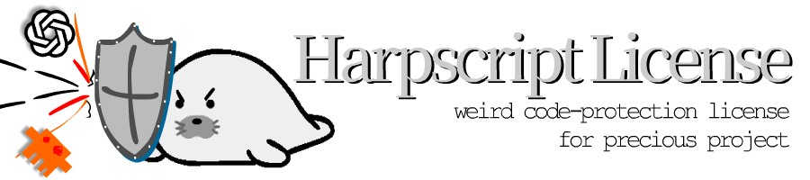

# harpscript_license v1.0
```
harpscript_license v1.0
(Project name) 
Copyright (Year) (Your name)

## WARNING
*THIS LICENSE IS NOT OPEN SOURCE LICENSE.*


This project's under the harpscript License v1.0

- [https://github.com/Noksek2/harpscript_license](https://github.com/Noksek2/harpscript_license)
- [https://codeberg.org/Noksek/harpscript_license](https://codeberg.org/Noksek/harpscript_license)

- Codeberg Only: Public forks and uploads are allowed only on Codeberg.

- Platform Restrictions: Platforms without explicit protection against scraping or AI training (e.g., GitHub, GitLab) are restricted to private forks and uploads only.

- No AI Training: AI training is strictly prohibited, with no protection against legal risks.

- Other Licenses: Allowed only if repos with harpscript license are excluded from public repos (kept private), and source credit is given.

- No Illegal Use: Any unlawful use is strictly banned.

- No Liability: Administrators are not liable for any legal issues.

- Commercial Use: Allowed if license terms are met, unless the admin specifies otherwise.

- Conflict with GPL / LGPL : This license may conflict with GPL and LGPL. We are not responsible for any violations or legal issues arising from the combination of GPL and LGPL licenses, as this is beyond the scope of Harpscript's license authority.
```


